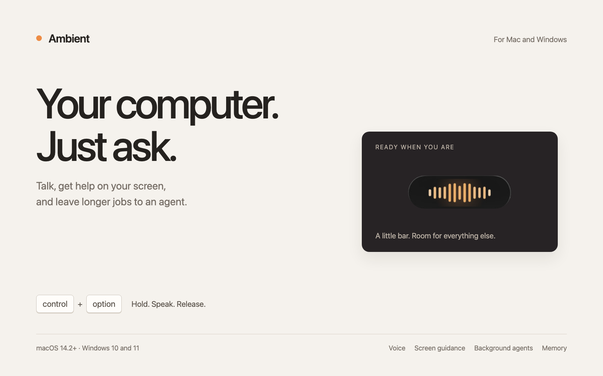

# Ambient



Ambient is a voice assistant for Mac and Windows that lives in a small translucent bar at the edge of your screen. Hold two keys, say what you want, and let go. It answers out loud, works in your connected apps, and can hand longer jobs to background agents, all without taking over your desktop.

On the Mac it is a native app (Swift, SwiftUI and AppKit); on Windows it is a Tauri app (see [Windows](#windows)). It was forked from [Clicky](https://github.com/farzaa/clicky) under the [MIT license](LICENSE).

## What it does

- **Talk to it.** Hold Control+Option, speak, release. Speech is recognised on your Mac when possible, and replies are spoken as they are written.
- **A bar, not a window.** The bar docks to any of the four screen edges. Drag it where you want it.
- **Shows you on your screen.** Ask where something is or how to do something and Ambient looks at your screen, then points or draws on it: arrows, circles, boxes, captions, even sketches. Drawings stay until you remove them.
- **Connected apps (source builds only for now).** Gmail, Calendar, Slack, GitHub, Notion and hundreds more through Composio, signed in from your browser with no API keys. The downloadable build does not include this yet: it needs the connector service, which is not hosted. See `connector/` to run it yourself.
- **Background agents.** Ask it to start an agent for research or a coding task. The agent runs headless on your publik account while you keep working, and reports back in the bar. If you have Codex or Claude Code installed, you can ask for those by name.
- **It learns.** Ambient remembers what matters as you use it, and you can see, edit or delete everything it knows. Skills are plain `SKILL.md` folders you can add your own to.
- **A guided tour.** First launch walks you through each of these on your real desktop.

## Requirements

- macOS 14.2 or later
- A [publik](https://publikhq.com) account. Ambient opens with Sign in with publik, which provides the AI, web search, transcription and speech.

Ambient asks for Microphone, Accessibility (for the global shortcut) and Screen Recording (only used when you ask about your screen). Speech Recognition is optional.

## Windows

Ambient also runs on Windows 10 and 11 (`windows/`). Install it by pasting this into PowerShell:

```powershell
irm https://raw.githubusercontent.com/jibberswrld/ambient/main/windows/install.ps1 | iex
```

It downloads the latest installer from this repository's releases, installs it for your user (no administrator prompt) and opens Ambient. You can also download `Ambient_<version>_x64-setup.exe` from a release yourself. That installer is not code signed yet, so Windows shows "Windows protected your PC" the first time: click **More info**, then **Run anyway**. That warning is about the missing certificate, not a detection; every build is made from this repository by GitHub Actions and is scanned by Microsoft Defender, and run under it, before it ships.

## Build from source

Requires Xcode and a Developer ID Application signing identity.

```bash
./scripts/run.sh
```

The script builds the `Ambient` scheme in Debug, checks the signature, and launches `build/Build/Products/Debug/Ambient.app`. It is set up for the maintainer's team ID; change `DEVELOPMENT_TEAM` in `scripts/run.sh` to your own to build locally.

Connected apps go through a small service in `connector/` that holds the Composio key; see its README to run it locally.

## Architecture

The app target links the local Swift package `Packages/AmbientKit`, with one target per subsystem (agent, background agents, connectors, memory and skills, interface), each depending only on a shared contracts target. `AGENTS.md` describes the architecture and conventions in detail.

```bash
cd Packages/AmbientKit && swift test
```

## Privacy

Usage counting: after you sign in, Ambient sends publik two events tied to your install key, `app_opened` at launch and `active_session` every 30 minutes while it is running. They carry the app name, version and operating system, and nothing you say, type or see. publik uses them to count weekly users, and you can turn this off in your publik account.

Recordings are transcribed on your Mac when on-device recognition is available. Nothing on your screen is captured unless your request needs it, and captures exclude Ambient's own windows. Memory and skills are stored as readable files under `~/Library/Application Support/Ambient/`.

## License

MIT. See [LICENSE](LICENSE), which keeps Clicky's original copyright alongside Ambient's.
