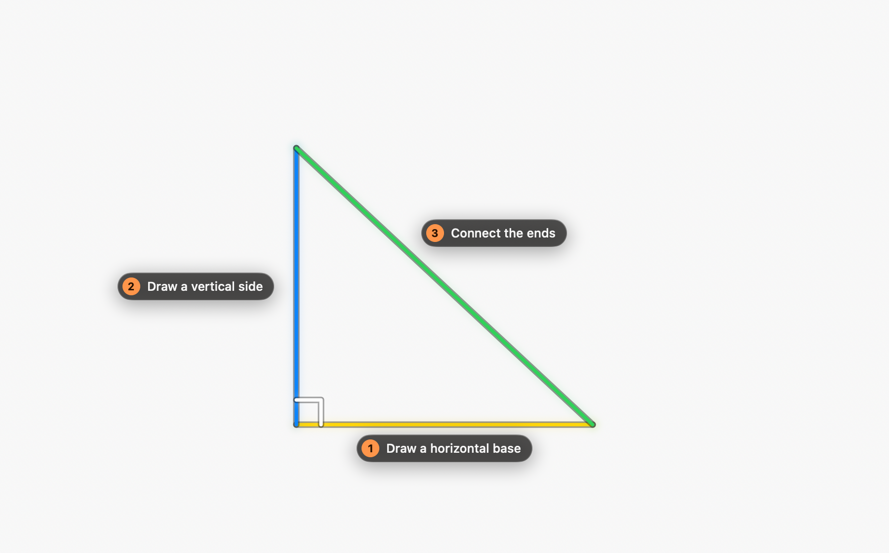
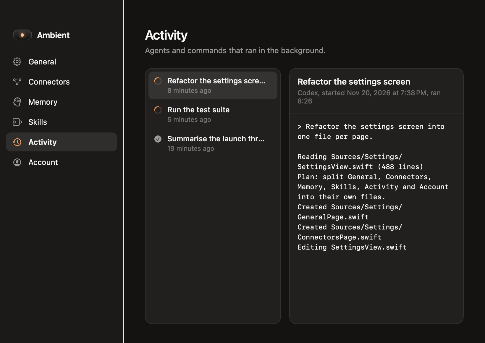
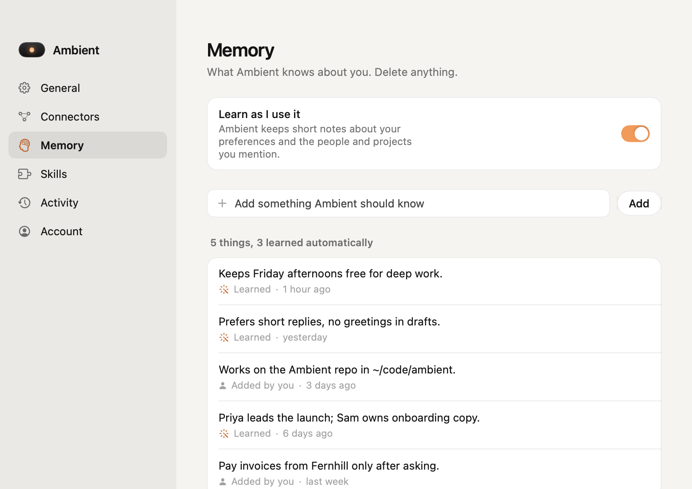

# Ambient

**Your Mac. Just ask.**

A voice assistant that answers aloud, helps with what is on your screen, and runs longer jobs in the background. All from a small bar at the edge of your desktop.


[**Download for Mac →**](https://publikhq.com/ambient) · [Latest release](https://github.com/jibberswrld/ambient/releases/latest) · macOS 14.2+

## Hold. Speak. Release.

Hold **Control + Option**, say what you need, and let go. Ambient speaks its reply while the words appear in the bar. Drag the bar to any screen edge and keep working in the app you already have open.

- **Ask a question.** Get an answer aloud, with web search when you need current information.
- **Ask about your screen.** “Where is that setting?” Ambient can look, point, and draw the next step right where you need it.
- **Hand off a longer job.** Start a research or coding agent, carry on with your work, then read its report when it finishes.
- **Build on what it knows.** Ambient remembers useful context. Review, edit or delete its notes, or turn learning off.

## Help you can see

Explain a diagram. Circle a control. Sketch an idea. Ambient can draw arrows, shapes, freeform lines and numbered captions over your screen. Drawings stay until you clear them or ask for a new drawing.



*An example rendered with Ambient's drawing interface.*

## Give the longer work to an agent

Ask Ambient to research a topic or work on a coding task. Its own background agent uses your publik account; you do not need a separate coding-agent subscription. You can follow its activity and open the finished report from the bar.

If you already use Codex or Claude Code, ask for either by name to use your installed CLI instead.



*Example tasks shown in the interface renderer.*

## Memory you can change

Useful context carries into the next conversation. Open Settings to see what Ambient remembers, add a note, remove one, or switch off automatic learning. Memory and skills live as readable files on your Mac.



You can also add your own skills as plain `SKILL.md` folders.

## Get started

1. [Download Ambient](https://publikhq.com/ambient), unzip it and move **Ambient.app** to Applications.
2. Open Ambient and **Sign in with publik**. Your publik account supplies AI, web search and spoken replies; usage follows [publik's plans and pricing](https://publikhq.com/pricing).
3. Follow the permissions guide, then hold **Control + Option** to try your first request. The guided tour teaches the bar on your real desktop.

**Requirements:** macOS 14.2 or later. Ambient asks for Microphone, Accessibility for the global shortcut, and Screen Recording for screen help. Speech Recognition is optional; on-device transcription is used when available, with publik transcription as a fallback.

**Current download:** Developer ID signed, but not yet notarized. Connected apps are currently available in source builds only: the hosted connector service is not deployed. Gmail, Calendar, Slack, GitHub, Notion and other Composio connections require running the service in [`connector/`](connector/README.md).

## Privacy

Ambient does not continuously capture your screen. It takes a screenshot only when your request needs one, excluding its own windows. Screen help sends the relevant capture to the AI service. Recordings are transcribed on your Mac when on-device recognition is available; fallback transcription uses publik. AI requests, web search and speech playback use online services.

Memory and skills are stored under `~/Library/Application Support/Ambient/`. You can inspect, edit or delete memory in Settings.

After sign-in, Ambient sends publik `app_opened` at launch and `active_session` every 30 minutes. These usage-counting events carry the app name, version and operating system, and nothing you say, type or see. You can turn usage counting off in your publik account.

## Build from source

Requires Xcode and an Apple Development signing identity.

```bash
./scripts/run.sh
```

The script builds the `Ambient` scheme in Debug, checks the signature, and launches `build/Build/Products/Debug/Ambient.app`. It is set up for the maintainer's team ID; change `DEVELOPMENT_TEAM` in `scripts/run.sh` to your own to build locally.

Connected apps go through the service in [`connector/`](connector/README.md), which holds the Composio key.

## Architecture

Ambient is native Swift, SwiftUI and AppKit. The app links the local `Packages/AmbientKit` library, with one target per subsystem, each depending only on a shared contracts target. [`AGENTS.md`](AGENTS.md) describes the architecture and conventions.

```bash
cd Packages/AmbientKit && swift test
```

The images above use Ambient's interface renderer with example content. Glass is simulated in offscreen captures; see the [capture notes](docs/ui-captures/README.md).

## License

Ambient is forked from [Clicky](https://github.com/farzaa/clicky) under the MIT license. [LICENSE](LICENSE) retains Clicky's original copyright alongside Ambient's.
